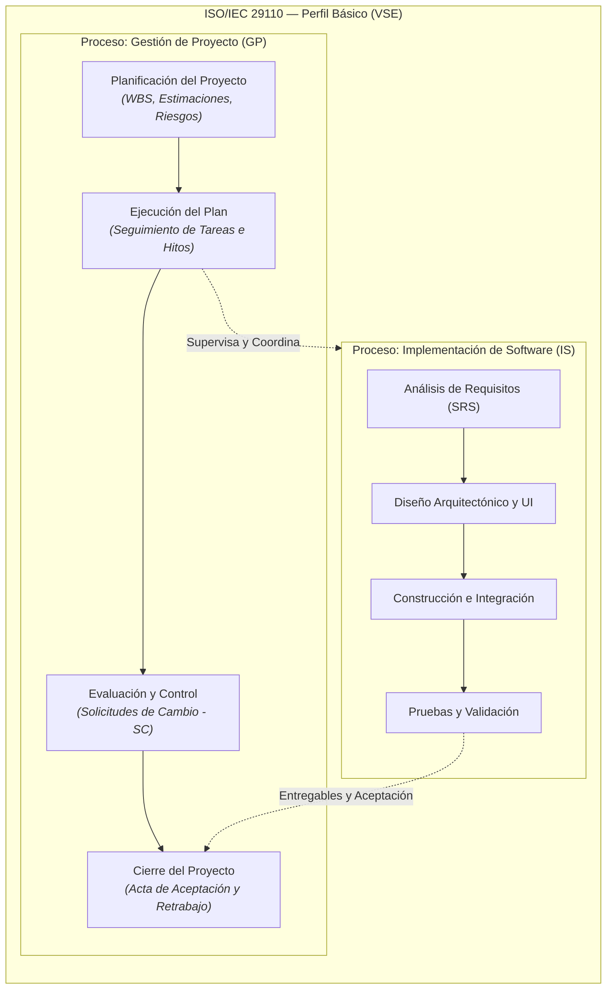

# 🏥 TurnoSalud — Implementación Estándar ISO/IEC 29110

<div align="center">


-007acc?style=for-the-badge)


<p align="center">
  <b>Gestión e Implementación de Procesos de Calidad de Software para una Muy Pequeña Entidad (VSE)</b>
  <br>
  <i>Caso Práctico: Sistema Web de Agendamiento de Citas Médicas para Clínica Privada</i>
</p>

</div>

---

## 📌 Descripción del Proyecto

**TurnoSalud** es una solución web orientada a la gestión y agendamiento de turnos para una clínica médica privada en Sangolquí. El propósito central de este repositorio es documentar la aplicación rigurosa de las directrices y buenas prácticas de ingeniería de software establecidas por el estándar internacional **ISO/IEC 29110** en su **Perfil Básico**.

A través de este caso, el **Grupo #5** simula la ejecución integral del ciclo de vida del proyecto, abarcando desde la planificación inicial, control de cambios y validación de requerimientos, hasta el cálculo de métricas de calidad (retrabajo) y el cierre formal mediante actas de aceptación.

---

## 🎯 Enfoque en el Estándar ISO/IEC 29110

El estándar **ISO/IEC 29110** (*Lifecycle profiles for Very Small Entities - VSEs*) está diseñado específicamente para organizaciones o proyectos con equipos de hasta 25 personas, ofreciendo una guía estandarizada, ágil y de baja sobrecarga documental para elevar la madurez y calidad del software.



### 🔍 ¿Por qué se seleccionó el Perfil Básico?
El proyecto cumple estrictamente las condiciones del **Perfil Básico** del *Grupo de Perfiles Genérico*:
* **Alcance único:** Desarrollo de un solo producto de software durante el ciclo de vida previsto (12 semanas).
* **Capacidad del equipo:** 6 personas (capacidad VSE del enunciado) = **72 personas-semana** (≈ **18 personas-mes**).
* **Presupuesto asignado:** **US$ 18,000**, equivalente a una tasa de esfuerzo de US$ 1,000 por persona-mes.
* **Criticidad:** Sistema no crítico para la vida humana o seguridad de infraestructura, encajando en el perfil genérico sin sobrecostes regulatorios pesados.

---

## 👥 Integrantes y Asignación de Roles (ISO/IEC 29110)

Para el desarrollo del taller académico, el equipo de 4 integrantes asume los roles clave definidos en la norma:

| Integrante | Rol en el Proyecto | Sigla ISO 29110 | Responsabilidades Principales |
| :--- | :--- | :---: | :--- |
| **Juan Quimbiulco** | Gestor de Proyecto / Programador | **GP** / **PR** | Planificación, control de cronograma, seguimiento de riesgos, actas y desarrollo. |
| **Martín Cordero** | Líder Técnico | **LT** | Arquitectura técnica, revisión de requisitos y validación de entregables. |
| **Alex Cuzco** | Analista / Diseñador | **AN** / **DIS** | Especificación de requisitos (SRS), diseño conceptual de interfaz y modelado. |
| **Stiven Díaz** | Programador | **PR** | Construcción de componentes, pruebas unitarias y control de versiones. |

---

## 📂 Estructura del Repositorio y Entregables

```text
TurnoSalud-ISO-29110-/
│
├── README.md                               # Documentación principal del repositorio
│
├── Documentación/                          # Actas y acuerdos formales de gestión
│   └── Acta_Reunión_1.pdf                 # Acta formal de inicio, asignación de roles y acuerdos
│
├── Parte01/                                # Taller Parte 1: Planificación y Fundamentación
│   └── Taller_TurnoSalud_Grupo5_Parte1.pdf # Perfil, Plan de Proyecto, WBS, Matriz de Riesgos
│
└── Parte02/                                # Taller Parte 2: Ejecución, Control y Cierre
    └── Taller_TurnoSalud_Grupo5_Parte2.pdf # Validación de Requisitos, Solicitud de Cambio (SC-001), Retrabajo y Acta Final
```

### 📑 Contenido Detallado de los Informes

#### 1. [Documentación / Acta de Reunión #1](Documentación/Acta_Reunión_1.pdf)
- Datos generales de la reunión de arranque (18 de noviembre de 2026).
- Selección fundamentada del perfil de la norma ISO/IEC 29110.
- Distribución oficial de responsabilidades y compromisos del equipo.

#### 2. [Parte 01 — Planificación y Marco Metodológico](Parte01/Taller_TurnoSalud_Grupo5_Parte1.pdf)
- **Elección del Perfil:** Justificación cuantitativa de esfuerzo (18 personas-mes) y límite VSE.
- **Plan del Proyecto (GP.1):**
  - Desglose de tareas y estimación de esfuerzo (WBS).
  - Cronograma de 12 semanas con definición de hitos entregables.
  - Matriz de gestión de riesgos y estrategias de mitigación.
  - Plan de control de versiones y repositorio centralizado en Git.

#### 3. [Parte 02 — Control, Gestión de Cambios y Cierre](Parte02/Taller_TurnoSalud_Grupo5_Parte2.pdf)
- **Validación de Requisitos:** Primera revisión formal con cliente y observaciones resueltas.
- **Gestión de Cambios (SC-001):** Registro, análisis de impacto técnico-económico, esfuerzo y aprobación.
- **Métricas de Calidad:**
  - Registro de horas invertidas en retrabajo por defectos y ajustes.
  - Cálculo formal del porcentaje de retrabajo sobre el esfuerzo total del proyecto.
- **Cierre del Proyecto:** Procedimiento de entrega en la semana doce y **Acta de Aceptación Final**.

---

## 📊 Métricas Clave del Proyecto

> [!NOTE]
> Las métricas reflejan el seguimiento estandarizado bajo el proceso de Gestión de Proyectos (GP).

| Métrica | Valor del Caso | Observaciones |
| :--- | :--- | :--- |
| **Duración del Ciclo** | 12 Semanas | Distribuidas en 4 fases de ejecución |
| **Capacidad Total** | 72 personas-semana | 6 personas de la VSE a tiempo completo |
| **Presupuesto Total** | $18,000 USD | $1,000 USD por persona-mes |
| **Gestión de Cambios** | 1 Solicitud (SC-001) | Evaluada con análisis de impacto y aprobada |
| **Trazabilidad** | 100% | Requisitos vinculados con entregables y actas de aceptación |

---

## 🏛️ Información Académica

* **Institución:** Universidad de las Fuerzas Armadas ESPE
* **Departamento:** Ciencias de la Computación
* **Asignatura:** Aseguramiento de la Calidad de Software
* **NRC:** 36845
* **Período:** P2 — Noviembre 2026

---

<div align="center">
  <sub>Desarrollado con rigor de calidad por el <b>Grupo #5</b> · 2026</sub>
</div>
